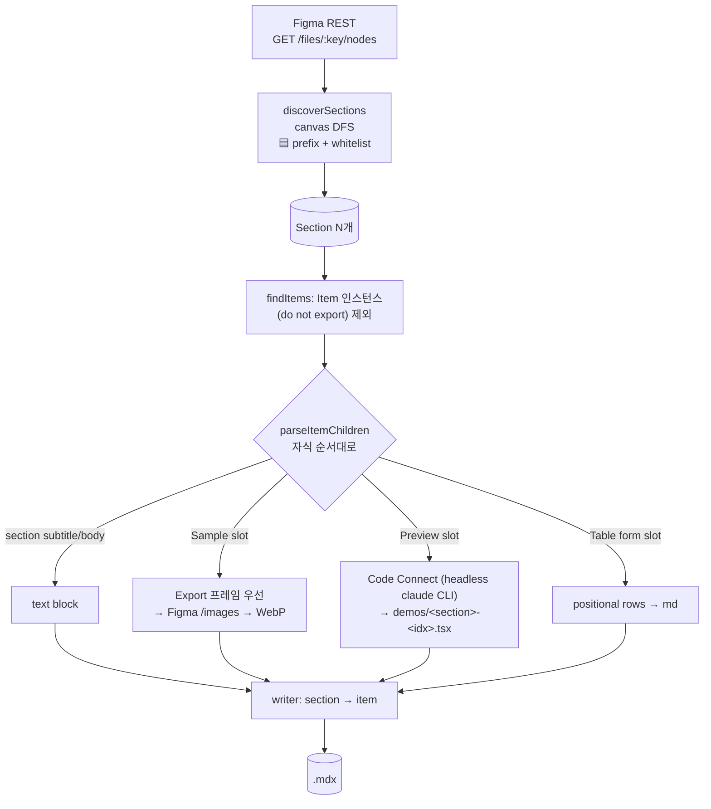
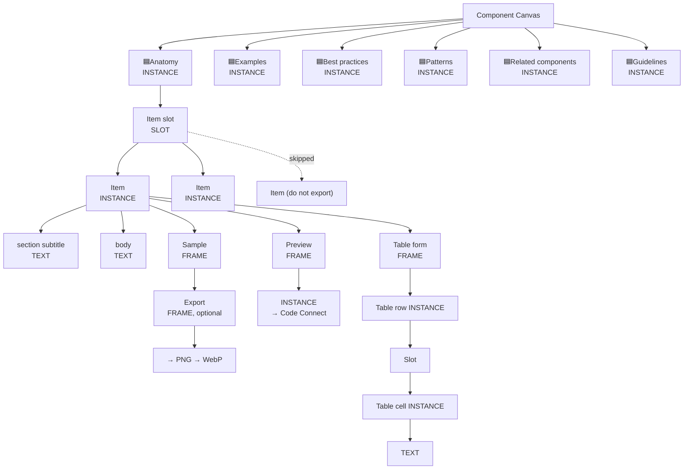

# extract-composites

Figma Composites 디자인 시스템 캔버스를 `apps/website`의 Composite 문서(MDX + demo TSX + WebP)로 추출.

## 추출 모델 (2단계)

```
Canvas
└─ Section (FRAME/INSTANCE, 이름 "🟦<Title>", 캔버스 DFS)   ← h2 대제목
   └─ Item (INSTANCE, 이름 "Item", "Item ...")              ← subtitle(h3) + body + slots
      ├─ TEXT  "section subtitle"        → ### <text>
      ├─ TEXT  "body"                    → paragraph
      ├─ FRAME "Sample"                  → image (Export 프레임 우선)
      ├─ FRAME "Preview"                 → <Demo file="demos/..." /> + demos/*.tsx
      └─ FRAME "Table form"              → markdown table
```

| 피그마 요소                | 조건                                                                                        | MDX 산출                                                                                                                    |
| -------------------------- | ------------------------------------------------------------------------------------------- | --------------------------------------------------------------------------------------------------------------------------- |
| **Section**                | 캔버스 DFS, `type === 'FRAME' \|\| 'INSTANCE'`, 이름 `startsWith('🟦')` + strip = whitelist | `## <title>` (🟦 strip + trim)                                                                                              |
| **Item** INSTANCE          | section 안 DFS, `name === 'Item'` 혹은 `startsWith('Item ')` / `'Item,'` / `'Item='`        | subtitle + body + slots 순서                                                                                                |
| `Item ... (do not export)` | section 안                                                                                  | 무시                                                                                                                        |
| `(do not export)` INSTANCE | item 안                                                                                     | 무시                                                                                                                        |
| TEXT `section subtitle`    | item 안                                                                                     | `### <text>`                                                                                                                |
| TEXT `body`                | item 안                                                                                     | paragraph                                                                                                                   |
| `Sample` 슬롯              | item 안                                                                                     | `` — Slot 안 `Export` 프레임 있으면 그 프레임을, 없으면 Slot 자체를 추출 |
| `Preview` 슬롯             | item 안                                                                                     | `<Demo file="demos/<section>-<idx>.tsx" />` + 코드는 Code Connect source                                                    |
| `Table form` 슬롯          | item 안                                                                                     | 마크다운 테이블 (첫 행 header)                                                                                              |

**Section Whitelist** (출력 순서): `Anatomy`, `Examples`, `Best practices`, `Patterns`, `Related components`, `Guidelines`.

- Section 매칭에 🟦 prefix **필수**. FRAME 또는 INSTANCE 양쪽 수용 (Figma 컴포넌트 템플릿은 INSTANCE).
- 캔버스 DFS로 전수 탐색, 매칭된 Section 내부는 하위 🟦 재귀 없음 (중첩 Section 금지).
- 같은 whitelist 이름이 여러 번 발견되면 첫 매치만 채택 + stderr 경고.
- 🟩 (legacy green prefix)는 **매칭 안 함**. 🟦만.
- 피그마에 없는 whitelist 항목은 skip (경고 없이).

## 파이프라인



## Figma 트리 구조



## 사용법

```sh
pnpm -C scripts/extract-composites extract \
  "https://www.figma.com/design/<fileKey>/-Composites--Vapor-Design-System?node-id=<node>"
```

### 플래그

| 플래그           | 기본값                   | 설명                                                        |
| ---------------- | ------------------------ | ----------------------------------------------------------- |
| `<figma-url>`    | required                 | Dev URL. `fileKey` + `node-id` 파싱                         |
| `--slug <slug>`  | 캔버스 `name` kebab-case | 출력 slug override                                          |
| `--only <names>` | 전체 섹션                | 콤마 구분 Section whitelist (예: `--only Anatomy,Examples`) |
| `--clean`        | false                    | MDX + public 디렉토리 삭제 후 재생성                        |
| `--force`        | false                    | `demos/*.tsx` 덮어쓰기(기본은 skip)                         |

## 환경 변수

| 이름           | 설명                                                                                                       |
| -------------- | ---------------------------------------------------------------------------------------------------------- |
| `FIGMA_TOKEN`  | required. Figma personal access token. 레포 루트 `.env`에서 자동 로드                                      |
| `CLAUDE_BIN`   | optional. Claude CLI 바이너리 경로 (default `claude`). Preview 데모 추출용 headless subprocess 호출에 사용 |
| `CLAUDE_MODEL` | optional. Claude 모델 ID (default `claude-haiku-5-5`). Opus 등으로 올리면 비용 상승                        |

## 출력

| 경로                                                                                 | 내용                                                              |
| ------------------------------------------------------------------------------------ | ----------------------------------------------------------------- |
| `apps/website/content/docs/composites/(components)/<slug>.mdx`                       | MDX 본문                                                          |
| `apps/website/content/docs/composites/(components)/<slug>/demos/<section>-<idx>.tsx` | Code Connect 데모 (수동 편집 가능; 기본 skip, `--force`로 덮어씀) |
| `apps/website/public/composites/<slug>/images/<section>-<idx>.webp`                  | Sample 이미지 (`Export` 우선, 없으면 Slot)                        |

## 설계 결정 요약

- Section은 🟦 prefix 가진 FRAME/INSTANCE. 이름 = 🟦 strip 후 trim, slug는 whitelist 고정 매핑.
- Section wrapper를 제거하고 🟦 서브섹션을 h2로 격상 — 문서 레벨이 한 단계씩 올라감 (subtitle은 h3).
- 캔버스 DFS로 전수 탐색. 매칭된 Section 내부로는 재귀 X (중첩 Section 금지).
- 중복 발견시 첫 매치 유지 + 경고. 출력 순서는 whitelist 순서 고정.
- `Item` 매칭은 base + variant prefix (`Item `, `Item,`, `Item=`). `(do not export)` 명시 제외.
- Sample 슬롯은 Slot 안 `Export` 프레임 우선, 없으면 Slot 자체.
- Preview 데모는 Figma Dev Mode의 Code Connect snippet을 headless Claude CLI(`claude -p ... --allowed-tools mcp__plugin_figma_figma__get_design_context`)로 받아와 `import { <Component> } from '@vapor-ui/composites'` + `export default function Demo()`로 감싸 저장. 매핑 없거나 subprocess 실패 시 TODO placeholder + stderr 경고. Claude CLI와 Figma MCP 연결이 전제.
- `demos/*.tsx`는 기본 skip (수동 편집 보존). 재추출은 `--force`.
- Table은 positional: 자식 index 0 = header, 나머지 = body. 셀 수 불일치는 패딩/trim + 경고.
- 모든 누락/오류는 soft(exit 0 + stderr 경고).
